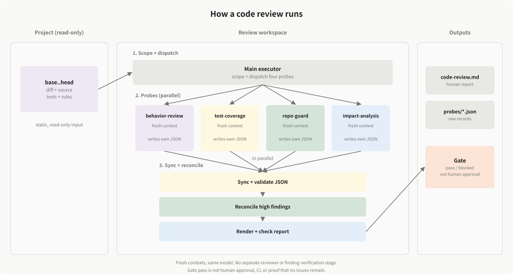

# code-review-skill

English | [简体中文](README.zh-CN.md)

**Evidence-backed code review. Static-first, probe-driven, and gated.**

The skill sources live in [`skills/code-review/`](skills/code-review/) (English) and [`skills/code-review-zh/`](skills/code-review-zh/) (Chinese), independently of any host's installation directory. The current stable release is `v0.1.1`; see [VERSION](VERSION).

[](https://claude.com/claude-code)
[](https://agentskills.io)
[](https://www.python.org/)
[](#what-this-is-not)
[](https://github.com/kyy-logs/code-review-skill/stargazers)

Most AI reviews stop at “this looks risky.” This skill produces a review you can audit: every finding points to a location, a contract or code path, and a severity; every gate decision is rendered from machine-readable JSON. It reads the diff, surrounding source, tests, and project rules — no build, test run, or coverage report required.

It never modifies the code under review.

## Latest news

<!-- NEWS:START -->
### v0.1.1 (2026-11-05)

#### Added

- code-review: surface unverified items and tighten behavior checks
- release: publish stable versions after validated VERSION changes

#### Fixed

- code-review: return immediately after saving probe JSON

[Full update history](NEWS.md)
<!-- NEWS:END -->

## Release status

`v0.1.1` is a stable release within the scope described below.
Pre-1.0 contract or format changes will be documented in [NEWS](NEWS.md).

- **Severity is three levels:** `high`, `medium`, `low`. Records written by the
  earlier four-level version, including any `critical` value, are **not
  compatible**; `collect-metrics` rejects them. Re-run the review or migrate the
  records before using them with this release.
- **Scope:** static-first review with four probes and JSON-derived report/gate
  output. It does not replace tests, CI, or human review.
- **Validation:** 87 offline pipeline, NEWS, installation, bilingual, and locale tests; clean-project
  end-to-end gate runs; additional probe smokes. These are regression checks,
  not a general recall claim. Concurrency-defect detection has not been
  validated.

For the next stable release, update `VERSION` (for example, to `0.1.1`) and push it to `main`. After Validate skills succeeds, the release workflow generates NEWS from commits, updates the README release information, and publishes the version tag and GitHub Release. Existing releases are preserved; failed CI does not publish.

## Contents

- [Latest news](#latest-news)
- [Release status](#release-status)
- [Why this skill](#why-this-skill)
- [Quick start](#quick-start)
- [How it works](#how-it-works)
- [Evidence contract](#evidence-contract)
- [Configuration](#configuration)
- [What this is not](#what-this-is-not)
- [Validation](#validation)
- [Requirements](#requirements)
- [Repository layout](#repository-layout)
- [Contributing](#contributing)
- [License](#license)

## Why this skill

**No self-grading.**

The implementation context does not sign off on its own work. Four probes run in fresh contexts, each files its own evidence, and the gate is derived from those records.

*This is separation of duties, not independent human adjudication; all probes still use the same model.*

| | |
|---|---|
| **Static-first** | Works on a fresh clone or a partial checkout. Coverage is optional, not a prerequisite. |
| **Evidence contract** | A finding without a location, summary, and checkable evidence is not a finding. |
| **Four probes** | Behavior, tests, rules, and impact are separate questions with separate reports. |
| **Machine-checkable gate** | Counts and blockers come from JSON, not from prose the model retyped. |
| **Auditable output** | The human report and the JSON records are rendered from the same source and verified against each other. |

## Quick start

### Install

Run this command **inside your project**:

```bash
# English (default)
npx -y skills add kyy-logs/code-review-skill --agent codex --skill code-review --yes

# Chinese
npx -y skills add kyy-logs/code-review-skill --agent codex --skill code-review-zh --yes
```

Use `--agent claude-code` for Claude Code. Codex installs to `.agents/skills/<skill>/`; Claude Code installs to `.claude/skills/<skill>/`. Node.js 22.20+ is required. Install one language per project. The Python installers also accept `--lang en|zh-CN` and default to English.

### Run

Ask in Claude Code:

```text
Review these changes with code-review.
```

Or invoke the skill directly:

```text
/code-review
```

For a fixed range:

```text
Use code-review on commits abc123..def456
```

The skill supports two review modes:

- `worktree` — staged, unstaged, and untracked changes against the current `HEAD`.
- `commits` — a fixed `base..head` range.

### Read the result

```text
docs/work/active/{slug}/
├── code-review.md      # human report
└── probes/
    ├── behavior-review.json
    ├── test-coverage.json
    ├── repo-guard.json
    └── impact-analysis.json
```

## How it works

<p align="center">
  
</p>

The four probes use the same model in fresh contexts. This is separation of duties, not independent human review. A passing gate is not human approval, CI, or proof that no issues remain. The current skill has no separate reviewer or finding-verification stage; raw findings feed the report and gate.

1. **Scope** — determine `worktree` or `commits`; record base and head as commit IDs.
2. **Probes** — dispatch four independent agents with the same scope and diff, each writing its own probe JSON. Run in batches if host capacity is limited, or record a serial fallback if agents are unavailable. Cross-probe duplicates are retained and counted; actual speed and token savings remain unverified.
3. **Sync** — validate probe JSON and derive counts with `collect-metrics`.
4. **Reconcile** — high findings must be closed or marked false-positive by the probe.
5. **Report** — render the human report’s fact sections from JSON, then verify them.
6. **Gate** — required-probe failures and open high findings block the merge.

### The four probes

| Probe | Required | Question it answers |
|---|---|---|
| `behavior-review` | yes | Does the changed behavior match its actual contract and implementation path? |
| `test-coverage` | yes | Are the tests meaningful, and is incremental coverage measured when data exists? |
| `repo-guard` | yes | Does the change violate repository or project rules? |
| `impact-analysis` | no | Who calls this, what contracts change, and what is the performance/architecture blast radius? |

Probes are intentionally narrow. `behavior-review` is not a linter, and `repo-guard` is not a general bug scanner.

### Language and stack coverage

The default `repo-guard` workflow selects `.java`, `.ts`, `.tsx`, and `.vue` files for pattern scanning. The built-in rule pack includes Java- and Spring-specific guidance; selecting an extension does not establish complete framework or language coverage.

AI semantic checks can inspect relevant code beyond those extensions, but their results depend on the model and available contracts, source, and tests. The historical cases below exercise particular stacks and skill snapshots; they do not establish equally validated support across all stacks. Use applicable project rules and record unverified dependencies or language-specific behavior.

## Evidence contract

Every finding records:

| Field | Meaning |
|---|---|
| `location` | `path:line`, or file level with a reason |
| `summary` | What is wrong — not “consider improving” |
| `evidence` | Contract, code path, test output, or rule ID |
| `severity` | `high` / `medium` / `low` |
| `status` | `open` / `reconciled` / `wontfix` / `false-positive` |

High-severity findings must cite the actual method signature and the contract they violate, or a concrete code path. A hunch is capped at `medium` until the evidence is checked.

## Configuration

`references/probes.yaml` controls the probe registry:

Project-specific rules can live in `.code-review/rules/`, or be pointed to with `CODE_REVIEW_RULES_DIR`:

```bash
export CODE_REVIEW_RULES_DIR=/path/to/rules
```

A project rule package **replaces** the built-in package; it is not merged with it.

## What this is not

- Not a replacement for tests, CI, or human review.
- Not a guarantee that a clean report means the change is correct.
- Not a coverage tool: coverage is used when provided, not required.
- Not a fixer: it does not modify the code under review.

## Validation

Offline tests check JSON validation, derived counts, report consistency, installation, and gate behavior. Passing them does not establish defect-detection recall, false-positive rates, or the correctness of an AI finding.

A controlled comparison against a single-agent review, measuring missed defects, false positives, wall-clock time, and token usage on the same cases and model configuration, has not yet been established. The historical runs below are snapshot-specific observations and do not demonstrate an improvement over that baseline.

<details>
<summary>11-case historical Java regression (2026-10-29)</summary>

- Baseline: commit `494a39bb`, before `behavior-review` was extracted into a standalone probe. The snapshot validates the shared finding and gate contract, not the four-probe split itself.
- 11/11 cases completed; static review.
- Original behavior targets: 5/5 hit; including two independently confirmed edge cases, 5/7 required targets were found.
- Clean and fixed controls: 4/4 passed without false blocking.
- Two confirmed edge-case misses remain: legal input formatting in a parser, and a JSON representation round-trip in command rendering.
- 33 raw findings: 8 high, 20 medium, 5 low; 0 confirmed false positives, with unverified items still open.
- The full merge gate was not run.

Risk areas exercised by these cases:

| Risk area | Cases | Observed result |
|---|---|---|
| Resource lifecycle | DBeaver | Found an input stream left open after copying; confirmed target. |
| Execution logic | Kestra, Keycloak guides | Found duplicate interpreter/command assembly in Kestra; confirmed target. Also reported switch fall-through in Keycloak, with downstream impact only partly supported. |
| Input boundaries and value handling | Lang-1, Spring AI Alibaba | Found hexadecimal overflow handling and blank-string sentinel problems; confirmed targets. The leading-zero return-type finding remained a contract dispute and was rated too high. |
| Permissions and data scope | Keycloak groups (m01), Elasticsearch | Found authorization resource IDs used as group IDs; confirmed target. The non-default filesystem permission-bypass candidate still needs threat-model and exploitability evidence. |
| API compatibility | Kestra | Identified public SPI return-type changes and new abstract methods; compatibility break supported, affected external plugins not measured. |
| Cache and state consistency | Keycloak login cache (m02) | Reported an invalidation risk involving organization-wrapped models; runtime consequences remain unverified. |
| Performance and repeated work | Elasticsearch, Kestra, Keycloak login cache | Reported logging overhead, repeated rendering/downloads, and extra lookups; performance impact was not benchmarked. |
| Test quality and regression protection | DBeaver, Keycloak, Kestra | Identified missing branch tests, tests bypassing the changed production entry point, and incorrect cleanup or cache-invalidation coverage. |

The two confirmed misses were Keycloak's valid `tileVisible = "false"`
syntax bypassing validation, and Kestra's JSON render/parse round-trip
corrupting command values containing quotes, backslashes, or newlines.

The four controls checked false alarms: the Lang-1 fix, normal pagination,
normal tag normalization, and a valid login-cache delegation path that should
not be reported as recursion. Passing a control does not establish that its
entire change is defect-free.

The evaluation harness and raw reports are kept out of the published repository. This snapshot is a regression result, not a claim of general recall.

</details>

<details>
<summary>9-case expansion (2026-10-30)</summary>

- Separate run `2026-10-30-review9-1a4adc1` on an older `main` (`1a4adc1`); it did not re-run the 11 historical cases. Do not combine the two batches into a 20/20 claim.
- 9/9 cases completed; 36/36 probe records; 0 probe errors or skipped cases.
- Positive targets: 4/6. Fixed controls: 3/3 stopped reporting.
- 22 raw findings: 7 high, 13 medium, 2 low. This older run used the reviewer (5 run / 4 skip); the current skill has no independent reviewer.
- Confirmed misses: x01's legal `d` flag and x04's cancellation/loading lifecycle.
- Severity or contract caveats remain for several cases, including x02, x05, x06, and x08; this is not a general recall claim.

</details>

## Requirements

- Claude Code with Agent Skills support, or Codex with custom-agent support.
- Bash 3.2+, Git, awk, grep, sed (macOS: invoke with `/bin/bash`; Linux/Windows Git Bash: `bash`).
- Python 3.9+ is required to run the review scripts; PyYAML is used for report parsing and metrics.
- Node.js 22.20+ is required for the `npx skills` install entry.

## Repository layout

```text
code-review-skill/
├── README.md
├── README.zh-CN.md
├── NEWS.md
├── LICENSE
├── VERSION
├── assets/
│   ├── code-review-architecture.svg
│   └── code-review-architecture.zh-CN.svg
├── .github/workflows/
│   ├── news-update.yml
│   ├── skill-validation.yml
│   ├── star-history.yml
│   └── sync-news.yml
├── scripts/
│   ├── check-skill-locales.py
│   ├── install
│   ├── install.py
│   ├── install-remote.py
│   ├── news-update.py
│   ├── sync-skill-scripts.py
│   └── sync-news.py
├── shared/scripts/
│   ├── collect-metrics
│   ├── lib-metrics
│   ├── rule-grep
│   └── sync-results.py
├── skills/
│   ├── code-review/
│   │   ├── SKILL.md
│   │   ├── assets/
│   │   ├── references/
│   │   └── scripts/
│   └── code-review-zh/
│       ├── SKILL.md
│       ├── assets/
│       ├── references/
│       └── scripts/
└── tests/
```

## Star history

[](https://star-history.com/#kyy-logs/code-review-skill&Date)

Updated daily by [`star-history.yml`](.github/workflows/star-history.yml).

## Contributing

Issues and pull requests are welcome. For a behavior change, include the review target (repo and base/head), expected and observed result or gate decision, and evidence that distinguishes them.

For a probe or schema change, update the probe document, output contract, and affected scripts together.

Run tests with `python -m unittest discover -s tests -v`; set `CODE_REVIEW_TEST_BASH` to include shell and installation checks. These tests do not call models or establish defect recall.

For user-facing changes, add an entry to `NEWS.md`. Pushes to `main` update the README news preview; locally, run `python scripts/news-update.py` and `python scripts/sync-news.py` (use `--check` to verify only). Keep the Chinese README aligned.

## License

This repository is distributed under the [MIT License](LICENSE).


## Project policy and output

Optional `.code-review/config.json` (paths relative to the reviewed project):

```json
{
  "output_dir": "docs/work",
  "line_target": 85,
  "branch_target": 80
}
```

85% / 80% are configurable defaults. Line coverage blocks below target; branch coverage is advisory.
Probes, gates, and reports use the same effective targets. `CODE_REVIEW_OUTPUT_DIR` overrides the output root;
pass identical settings to every shell invocation. Source inspection is read-only, but the workflow writes
`active/<slug>/code-review.md`, `probes/*.json`, `policy.json`, root-level `workflow-events.log`,
and scorecards / `quality-trend.csv` on archive.
Start a new review with `bash "$CODE_REVIEW_SKILL_DIR/scripts/collect-metrics" init <unique-slug>`.
Existing active, archived, or event-history slugs are rejected. Re-rendering the same run updates only automatic report regions;
do not run concurrent writers for the same run. policy.json records the initialization snapshot; keep configuration stable when
resuming, and re-check findings and re-render after policy changes.
The minimum shell is Bash 3.2. macOS can use `/bin/bash`; Linux / Windows Git Bash use `bash`.
A macOS CI job is configured; a passing macOS result has not been established locally.
