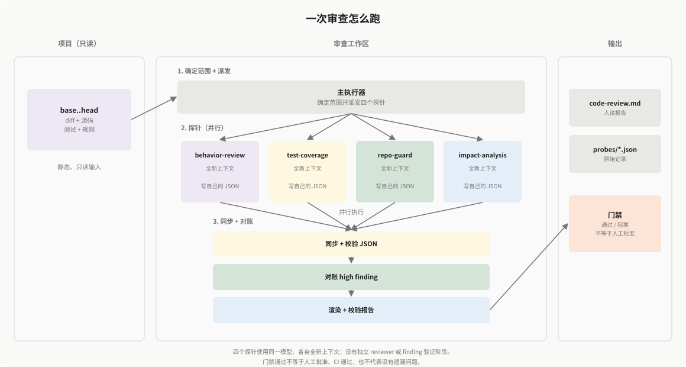

# code-review-skill

[English](README.md) | 简体中文

**基于证据的代码审查：优先静态分析，使用探针分工，并根据结果执行门禁。**

技能源码位于 [`skills/code-review/`](skills/code-review/)（英文）和 [`skills/code-review-zh/`](skills/code-review-zh/)（中文），与宿主工具的安装目录分离。当前正式版本为 `v0.1.1`，版本号见 [VERSION](VERSION)。

[](https://claude.com/claude-code)
[](https://agentskills.io)
[](https://www.python.org/)
[](#能力边界)
[](https://github.com/kyy-logs/code-review-skill/stargazers)

许多 AI 审查只给出“这里可能有风险”的判断。这个 skill 生成可核对的审查结果：每条问题都有位置、契约或代码路径依据，以及严重级别；门禁结论由机器可读的 JSON 派生。审查会读取 diff、相关源码、测试和项目规范，无须先构建项目、运行测试或生成覆盖率报告。

审查过程不会修改被审代码。

## 最新动态

### v0.1.1（2026-11-05）

本版本更新根据提交记录自动整理，详见 [NEWS](NEWS.md) 和 [Release](https://github.com/kyy-logs/code-review-skill/releases/tag/v0.1.1)。

## 发布状态

`v0.1.1` 是下述适用范围内的正式版本。1.0 之前的契约或格式变更会在 [NEWS](NEWS.md) 中说明。

- **三级评级**：`high`、`medium`、`low`。此前四级版本写入的记录，包括包含 `critical` 值的记录，**不兼容**当前版本；`collect-metrics` 会拒绝这些记录。使用前请重新审查，或显式迁移记录。
- **适用范围**：以静态分析为主，使用四个探针，以及从 JSON 派生的报告和门禁。不能替代测试、CI 或人工审查。
- **验证情况**：116 项审查流程、NEWS、安装、双语、结构与源码新鲜度离线测试；干净项目中的端到端门禁验证；额外的探针冒烟验证。这些属于回归检查，不能据此宣称具备通用召回能力。并发缺陷识别尚未验证。

下次发布正式版时，只需修改 `VERSION`（例如 `0.1.1`）并推送 `main`。Validate skills 通过后，发布流程自动根据提交整理 NEWS、同步 README 版本信息、打标签并发布 GitHub Release。已有版本不覆盖，CI 失败不发布。

## 目录

- [最新动态](#最新动态)
- [发布状态](#发布状态)
- [为什么使用这个技能](#为什么使用这个技能)
- [快速开始](#快速开始)
- [工作流程](#工作流程)
- [证据契约](#证据契约)
- [配置](#配置)
- [能力边界](#能力边界)
- [验证情况](#验证情况)
- [运行环境](#运行环境)
- [仓库结构](#仓库结构)
- [参与贡献](#参与贡献)
- [许可证](#许可证)

## 为什么使用这个技能

**自己出的题，自己不许批卷。**

写代码的上下文不参与验收；四个探针各自在全新上下文里交卷，各自落盘证据，gate 只看这些记录。

*这是职责隔离，不是独立人工审计；所有探针仍使用同一模型。*

| 特点 | 作用 |
|---|---|
| **优先静态分析** | 新克隆的仓库或不完整检出也能审查。覆盖率数据可选，不作为前置条件。 |
| **证据契约** | 每条问题必须有位置、摘要和可核对的证据。 |
| **四个探针分工** | 分别检查行为、测试、规范和影响，各自产出独立记录。 |
| **可由脚本检查的门禁** | 计数和阻塞项由 JSON 派生。 |
| **可核对的输出** | 人读报告和 JSON 使用同一份数据，并检查两者是否一致。 |

## 快速开始

### 安装

**在你的项目目录中**执行：

```bash
# 英文（默认）
npx -y skills add kyy-logs/code-review-skill --agent codex --skill code-review --yes

# 中文
npx -y skills add kyy-logs/code-review-skill --agent codex --skill code-review-zh --yes
```

Claude Code 使用 `--agent claude-code`。Codex 安装到 `.agents/skills/<skill>/`，Claude Code 安装到 `.claude/skills/<skill>/`。需要 Node.js 22.20+。项目内只安装一种语言。Python 安装器也支持 `--lang en|zh-CN`，默认英文。

### 运行

在 Claude Code 中提出请求：

```text
帮我 review 这次改动
```

也可以直接调用：

```text
/code-review-zh
```

审查固定提交区间：

```text
使用 code-review-zh 审查提交 abc123..def456
```

支持两种模式：

- `worktree`：审查相对于当前 `HEAD` 的暂存、未暂存和未跟踪改动。
- `commits`：审查固定的 `base..head` 提交区间。

### 查看结果

```text
docs/work/active/{slug}/
├── code-review.md      # 人读报告
├── policy.json
├── review-snapshot.json
└── probes/
    ├── behavior-review.json
    ├── test-coverage.json
    ├── repo-guard.json
    └── impact-analysis.json
```

## 工作流程

<p align="center">
  
</p>

四个探针使用同一模型、各自在全新上下文中执行；这是职责隔离，不是独立人工审计。门禁通过不等于人工批准、CI 通过，也不代表没有遗漏问题。当前 skill 没有独立的 reviewer 或 finding 验证阶段；原始 finding 直接进入报告和门禁。

1. **确定范围**：选择 `worktree` 或 `commits`，将 base 和 head 记录为 commit ID，再用 `--mode` 初始化本轮并生成 `review-snapshot.json`。
2. **探针检查**：派发四个独立代理，使用同一份范围和 diff，各自写自己的探针 JSON。宿主槽位不足时分批执行；没有代理能力时记录串行回退。跨探针重复问题暂时保留并计数，实际提速和 token 节省尚未验证。
3. **同步**：使用 `collect-metrics` 校验探针 JSON 并计算数量。
4. **对账**：high 问题需要关闭，或被 probe 标为误报。
5. **报告**：从 JSON 生成人读报告的事实区，再校验展示内容。
6. **门禁**：源码新鲜度、必需探针失败、存在未处理的 high 问题时，阻塞合并。

### 四个探针

| 探针 | 是否必需 | 回答的问题 |
|---|---|---|
| `behavior-review` | 是 | 改动后的行为是否符合实际契约和实现路径？ |
| `test-coverage` | 是 | 测试是否有效；有覆盖率数据时，是否核对增量覆盖？ |
| `repo-guard` | 是 | 改动是否违反仓库或项目规范？ |
| `impact-analysis` | 否 | 哪些调用方受影响，哪些契约变化，对性能和架构有什么影响？ |

各探针保持明确职责：`behavior-review` 不负责一般格式检查，`repo-guard` 不承担通用行为缺陷扫描。

### 语言与技术栈覆盖范围

默认 `repo-guard` 流程选择 `.java`、`.ts`、`.tsx`、`.vue` 文件进行模式扫描。内置规则包包含 Java、Spring 专用指导；某种扩展名进入扫描范围，不代表已完整覆盖该语言或框架。

AI 语义检查可以读取这些扩展名之外的相关代码，但结果取决于模型和可用的契约、源码、测试。下方历史案例只验证了特定技术栈和技能快照，不能据此认为所有技术栈都经过同等验证。使用适用的项目规则，并记录尚未核实的依赖或语言特有行为。

## 证据契约

每条问题包含：

| 字段 | 含义 |
|---|---|
| `location` | `path:line`；若使用文件级位置，需要说明原因 |
| `summary` | 明确描述问题 |
| `evidence` | 契约、代码路径、测试输出或规则 ID |
| `severity` | `high` / `medium` / `low` |
| `status` | `open` / `reconciled` / `wontfix` / `false-positive` |

high 问题必须引用实际方法签名及违反的契约，或给出具体代码路径。尚未核实证据的推测，最高为 `medium`。

## 配置

`references/probes.yaml` 管理探针注册：

项目规范可以放在 `.code-review/rules/` 中，也可以通过 `CODE_REVIEW_RULES_DIR` 指定：

```bash
export CODE_REVIEW_RULES_DIR=/path/to/rules
```

项目规则包会**替换**内置规则包，两者不会合并。

## 能力边界

- 不能替代测试、CI 或人工审查。
- 没有发现问题，不代表改动一定正确。
- 不负责生成覆盖率；提供数据时才使用覆盖率数据。
- 不负责自动修复，不修改被审代码。

## 验证情况

离线测试检查 JSON 校验、派生计数、报告一致性、安装和门禁行为。测试通过不能证明缺陷召回率、误报率或 AI finding 的语义正确性。

目前尚未建立与单代理审查的受控对照：在相同案例和模型配置下，同时统计漏报、误报、墙钟时间及 token 用量。下方历史运行仅说明对应快照的观察结果，不能证明相对于该基线有提升。

<details>
<summary>11 个历史 Java 案例回归（2026-10-29）</summary>

- 基线为 `494a39bb`，当时尚未将 `behavior-review` 拆为独立探针。本快照验证共享的问题记录和门禁契约，不代表已验证四探针拆分。
- 11/11 案例完成；采用静态审查。
- 原始行为目标命中 5/5；纳入另外两个独立确认的边界缺陷后，应报目标合计命中 5/7。
- 正常与修复对照 4/4 通过，未发生错误阻塞。
- 存在两项确认漏报：解析器的合法输入格式，以及命令渲染中的 JSON 表示往返转换。
- 原始发现 33 条：8 high、20 medium、5 low；确认误报 0 条，但仍有未验证项，不能据此认定误报率为零。
- 未执行完整合并门禁。

这些案例实际覆盖的风险：

| 风险维度 | 对应案例 | 实际结果 |
|---|---|---|
| 资源生命周期 | DBeaver | 发现复制完成后未关闭输入流，命中确认目标。 |
| 执行逻辑 | Kestra、Keycloak 指南 | 发现 Kestra 重复组装解释器和命令，命中确认目标。另报告 Keycloak 的 switch 落穿，下游影响仅获部分支持。 |
| 输入边界与值处理 | Lang-1、Spring AI Alibaba | 发现十六进制溢出处理和空白字符串哨兵问题，命中确认目标。前导零导致返回类型变化的问题仍有契约争议，原评级偏高。 |
| 权限与数据范围 | Keycloak 组权限（m01）、Elasticsearch | 发现把授权资源 ID 当作组 ID，命中确认目标。非默认文件系统绕过权限检查的候选问题，仍需威胁模型与可利用性证据。 |
| API 兼容性 | Kestra | 识别公共 SPI 返回类型变化及新增抽象方法，兼容性破坏有依据；未统计实际受影响的外部插件。 |
| 缓存与状态一致性 | Keycloak 登录缓存（m02） | 报告组织包装后的模型影响缓存失效判断的风险，运行时后果尚未验证。 |
| 性能与重复工作 | Elasticsearch、Kestra、Keycloak 登录缓存 | 报告日志开销、重复渲染或下载、额外查询；未通过基准测试衡量性能影响。 |
| 测试质量与回归保护 | DBeaver、Keycloak、Kestra | 识别关键分支缺少测试、测试绕过变更后的生产入口、测试清理错误，以及缓存失效分支未被覆盖。 |

两项确认漏报分别是：Keycloak 的合法 `tileVisible = "false"` 写法绕过校验；Kestra 的 JSON 渲染与解析往返转换损坏含引号、反斜杠或换行的命令值。

四个对照检查是否误报：Lang-1 修复、正常分页、正常标签规范化，以及不应被误判为递归的合法登录缓存委托路径。某个对照通过，不代表其全部改动都没有缺陷。

评测工具和原始报告不放入发布仓库。这份快照只说明历史回归结果，不能据此宣称通用召回能力。

</details>

<details>
<summary>9 个扩展案例（2026-10-30）</summary>

- 独立批次 `2026-10-30-review9-1a4adc1`，使用旧版 `main`（`1a4adc1`），没有重跑 11 个历史案例；不能把两批合并宣称 20/20。
- 9/9 案例完成；36/36 探针记录；0 执行错误或跳过。
- 正例目标：4/6；修复对照：3/3 目标停止上报。
- 原始 findings 22 条：7 high、13 medium、2 low。该旧批次仍使用 reviewer（5 次 run、4 次 skip）；当前 skill 已移除独立 reviewer。
- 确认漏报：x01 的合法 `d` flag，以及 x04 的取消/loading 生命周期问题。
- x02、x05、x06、x08 等仍有 severity 或契约争议；本批次不构成通用召回声明。

</details>

## 运行环境

- 支持 Agent Skills 的 Claude Code，或支持自定义 agent 的 Codex。
- Bash、Git、awk、grep、sed。
- 运行审查脚本需要 Python 3.9+；PyYAML 用于报告解析和指标处理。
- `npx skills` 安装入口需要 Node.js 22.20+。

## 仓库结构

```text
code-review-skill/
├── README.md
├── README.zh-CN.md
├── NEWS.md
├── LICENSE
├── VERSION
├── assets/
│   ├── code-review-architecture.svg
│   └── code-review-architecture.zh-CN.svg
├── .github/workflows/
│   ├── news-update.yml
│   ├── skill-validation.yml
│   ├── star-history.yml
│   └── sync-news.yml
├── scripts/
│   ├── check-skill-locales.py
│   ├── install
│   ├── install.py
│   ├── install-remote.py
│   ├── news-update.py
│   ├── sync-skill-scripts.py
│   └── sync-news.py
├── shared/scripts/
│   ├── collect-metrics
│   ├── lib-metrics
│   ├── rule-grep
│   └── sync-results.py
├── skills/
│   ├── code-review/
│   │   ├── SKILL.md
│   │   ├── assets/
│   │   ├── references/
│   │   └── scripts/
│   └── code-review-zh/
│       ├── SKILL.md
│       ├── assets/
│       ├── references/
│       └── scripts/
└── tests/
```

## Star 趋势

[](https://star-history.com/#kyy-logs/code-review-skill&Date)

由 [`star-history.yml`](.github/workflows/star-history.yml) 每天自动更新。

## 参与贡献

欢迎提交 issue 和 pull request。行为变更请附：审查目标（仓库及 base/head）、预期与实际结果/门禁结论，以及区分二者的证据。

探针或 schema 变更时，请同步更新探针文档、输出契约和相关脚本。

用 `python -m unittest discover -s tests -v` 运行测试；设置 `CODE_REVIEW_TEST_BASH` 可包含 shell 和安装检查。这些测试不调用模型，也不能证明缺陷召回能力。

面向用户的变化写入 `NEWS.md`。push 到 `main` 会更新 README 新闻预览；本地可用 `python scripts/news-update.py` 和 `python scripts/sync-news.py`，加 `--check` 只做校验。修改英文文档时请同步更新本中文版。

## 许可证

本仓库使用 [MIT 许可证](LICENSE)。


## 项目策略与输出

可选项目配置 `.code-review/config.json`，相对路径按被审项目根目录解析：

```json
{
  "output_dir": "docs/work",
  "line_target": 85,
  "branch_target": 80
}
```

85% / 80% 是可配置默认值；行覆盖率参与阻塞，分支仅提示。探针、门禁和报告使用相同有效阈值。
`CODE_REVIEW_OUTPUT_DIR` 可覆盖产物根目录；独立 shell 调用须传入同样配置。
源码检查只读，但流程会写入 `active/<slug>/code-review.md`、`probes/*.json`、`policy.json`、`review-snapshot.json`、
根目录的 `workflow-events.log`，以及 archive 命令生成的 scorecard 和 `quality-trend.csv`。
新审查先执行 `bash "$CODE_REVIEW_SKILL_DIR/scripts/collect-metrics" init <unique-slug> --mode worktree`
（或 `--mode commits --base <base> [--head <head>]`）。带 `--mode` 时 init 会写入 `review-snapshot.json`；
新审查应始终传入。省略 `--mode` 保持旧行为，并跳过新鲜度校验。
同名活动目录、归档或历史事件存在时拒绝创建。同轮重渲染仅更新报告自动区域；不应并发写同一轮。
记录的 policy.json 是初始化策略；继续同轮时保持配置不变，改变阈值后须重新检查并渲染报告。
`gate-pass code-review` 会重算 `review-snapshot.json`，被审源码变化时返回 `stale-review`；
修复后执行 `snapshot <slug>` 重铸快照并重新审查。
最低 shell 为 Bash 3.2；macOS 可用 `/bin/bash`，Linux / Windows Git Bash 用 `bash`。
macOS CI 已配置，尚未在本机验证 macOS；CI 通过后才可声称该平台验证通过。
